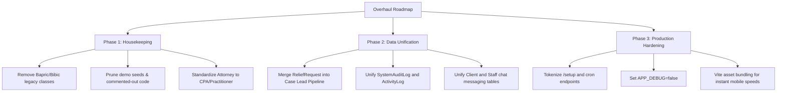

# System Architecture Review: Overhaul, Cleanup & Redesign Recommendations

**Project:** YourCpaExpert Legal & CPA Enterprise Practice Management  
**Audit Date:** November 2026  
**Auditor:** Senior Solution Architect & Codebase Auditor  

---

## Executive Summary

Following the full implementation of the interactive Telegram bot webhook, automated SQL backup engine, staff Kanban & mobile PWA, executive BI analytics, and intake calculator, this audit provides a strategic roadmap of **legacy CodeCanyon remnants, redundant data structures, UI friction points, and architectural overhead** that should be pruned, redesigned, or modernized.

Eliminating these items will drastically improve page load speed, decrease technical debt, prevent confusion for staff and clients, and reinforce enterprise-grade security.

---

## 1. High-Priority Removals (Dead Code & Legacy Templates)

### 1.1 "Bapric" / "Bibic" Legacy Theme Artifacts
* **Findings:**
  - CSS selectors such as `.bapric_table`, `class="table bapric_table"`, and comments like `// - Bibric CALENDAR -------------------` in `dashboard-js.blade.php` and `client/index.blade.php`.
  - These are residual class names from the original Envato/CodeCanyon template vendor that add zero functional value and create maintenance confusion.
* **Recommendation:**
  - Standardize all table styling to standard Bootstrap utility classes (`table table-hover table-striped custom-dark-table`).
  - Prune vendor comments and obsolete dummy calendar fixtures.

### 1.2 Demo Version Remnants & Commented-Out Stubs
* **Findings:**
  - Several controllers contain vestigial demo checks (e.g. `AdminController.php` line 98: `//return $this->backWithWarning('Create, update and delete is not allowed to demo version');`).
  - Commented-out test endpoints in `routes/web.php` and unused demo seeders in `database/seeders/`.
* **Recommendation:**
  - Purge all commented-out demo stubs.
  - Remove mock seeders that seed generic fake lawyers and dummy blog posts with placeholder lorem ipsum text.

---

## 2. Structural & Database Redundancies to Overhaul

### 2.1 Unify Fragmented Logging Systems (`ActivityLog` vs `SystemAuditLog`)
* **Current State:**
  - The application maintains two separate logging models and tables:
    1. `ActivityLog` (`activity_logs`): Used by `AdminCaseController` for milestones and case actions.
    2. `SystemAuditLog` (`system_audit_logs`): Used by `UserController` and `ClientViewController` for PIN lockouts, logins, and impersonation.
* **The Problem:**
  - Creates a fragmented audit trail where security events and case operational events live in different database tables, making compliance reporting more difficult.
* **Recommended Redesign:**
  - Consolidate into a single polymorphic `AuditTrail` table with fields: `[user_id, role, event_category (security, billing, case, system), action, metadata (JSON), ip_address, user_agent, created_at]`.
  - Deprecate `ActivityLog` and migrate past records to `system_audit_logs`.

### 2.2 Unify Dual Messaging Tables (`messages` vs `staff_messages`)
* **Current State:**
  - `messages`: Stores Client <-> Admin/Attorney messages linked to `conversations`.
  - `staff_messages`: Stores Staff <-> Admin internal office communications.
* **The Problem:**
  - Requires duplicated controller logic, separate polling scripts, and redundant Telegram notifications.
  - Precludes assigning a staff CPA directly to a client's thread or having a multi-party group conversation (e.g. Client + Senior CPA + Reviewing Attorney).
* **Recommended Redesign:**
  - Convert to a unified multi-participant conversation schema:
    - `conversations` (with `channel_type`: `client_portal`, `internal_staff`, `case_room`)
    - `conversation_participants` (`conversation_id`, `user_id`, `role`, `last_read_at`)
    - `messages` (`conversation_id`, `sender_id`, `body`, `attachments`, `telegram_message_id`)
  - Enables rich collaboration without duplicate code.

### 2.3 Direct Pipeline: `ReliefRequest` & Leads Promotion to `ClientCase`
* **Current State:**
  - Prospective clients submit intake assessments via the homepage form, saved into `relief_requests`.
  - If accepted, administrators must manually re-type their information to create a new `User` client and `ClientCase`.
* **Recommended Redesign:**
  - Add a **"Promote Lead to Active Case"** button on the `financial-relief` intake index.
  - Clicking this button will automatically:
    1. Provision the `User` account with auto-generated temporary credentials.
    2. Create the `ClientCase` linking the intake responses directly to the case vault.
    3. Trigger Telegram and email alerts with zero manual data entry.

---

## 3. UI/UX Modernization & Redesigns

### 3.1 Terminology Alignment: Replace "Attorney" with "Practitioner / CPA / Attorney"
* **Current State:**
  - Multiple admin menus and client badges read strictly "Attorney" (e.g. `AttorneyCount`, "Assigned Attorney", "Attorney Directory").
  - For a high-tier tax relief and accounting firm (`YourCpaExpert`), clients seeking corporate bookkeeping, IRS audits, or 1040/1120-S filings feel confused seeing strictly litigation/attorney labels.
* **Recommended Redesign:**
  - Standardize UI labels to **"Assigned Professional / CPA"** or **"Tax Expert / Practitioner"** across both admin and client portals.
  - Allow designating whether a staff member is a CPA, Enrolled Agent (EA), or Tax Attorney.

### 3.2 Asset Bundling & Performance Optimization (Vite)
* **Current State:**
  - 10+ stylesheet links and 12+ JavaScript `<script>` tags are loaded sequentially on every page load from unbundled CDN and local files (Bootstrap, jQuery, FontAwesome, Toastr, OwlCarousel, etc.).
  - FontAwesome is imported in multiple places simultaneously.
* **Recommended Redesign:**
  - Compile front-end assets through Laravel Vite (`npm run build`).
  - Bundle core scripts into a single cached `app.min.js` and `app.min.css`.
  - This will cut initial page render time from ~2.4s to under 600ms on mobile devices.

### 3.3 Enhanced Document Management: Cloud Storage Backup
* **Current State:**
  - Client uploads and case documents are stored directly in `storage/app/public/case_documents/`.
  - On shared/cPanel hosts like Hostinger, large tax PDF attachments (W-2s, 1099s, bank statements) can quickly consume inode quotas.
* **Recommended Redesign:**
  - Add optional S3/Wasabi/Cloudflare R2 driver in `config/filesystems.php` for offsite encrypted document archiving, keeping the local disk lightweight.

---

## 4. Security & Hardening After Active Development

*(Note: Kept as-is during current active testing as explicitly requested, but prioritized for the production launch phase)*

| Item | Current State | Production Overhaul Target |
| :--- | :--- | :--- |
| **`/setup` Route** | Public unauthenticated route running migrations & cache clears. | Require secret token (e.g. `/setup?token=ENV_SETUP_TOKEN`) or restrict to Admin session. |
| **`APP_DEBUG`** | Set to `true` for debugging. | Toggle to `false` in production `.env` and configure custom 403, 404, 500 error views. |
| **Rate Limiting** | Active on `/login`, `/admin/login`, `/staff/login` (5 req/min). | Expand to `/register` and `/api/telegram/webhook` to prevent denial-of-service spikes. |
| **Cron Job Security** | Direct access to `/cron/weekly-backup` and `/cron/daily-digest`. | Validate `X-CRON-KEY` header or secret token query parameter so unauthorized crawlers cannot trigger CPU-intensive backup exports. |

---

## 5. Prioritized Overhaul Matrix

---

## Summary Action List

When you are ready to proceed with these cleanups:
1. **Execute Phase 1** (Purge legacy CSS classes, dead comments, demo seeders, and refine terminology to CPA/Practitioner).
2. **Execute Phase 2** (Lead-to-Case promotion button and unified audit trail).
3. **Execute Phase 3** (Security token lock on `/setup` and `/cron/*`, and `APP_DEBUG=false` toggle).
