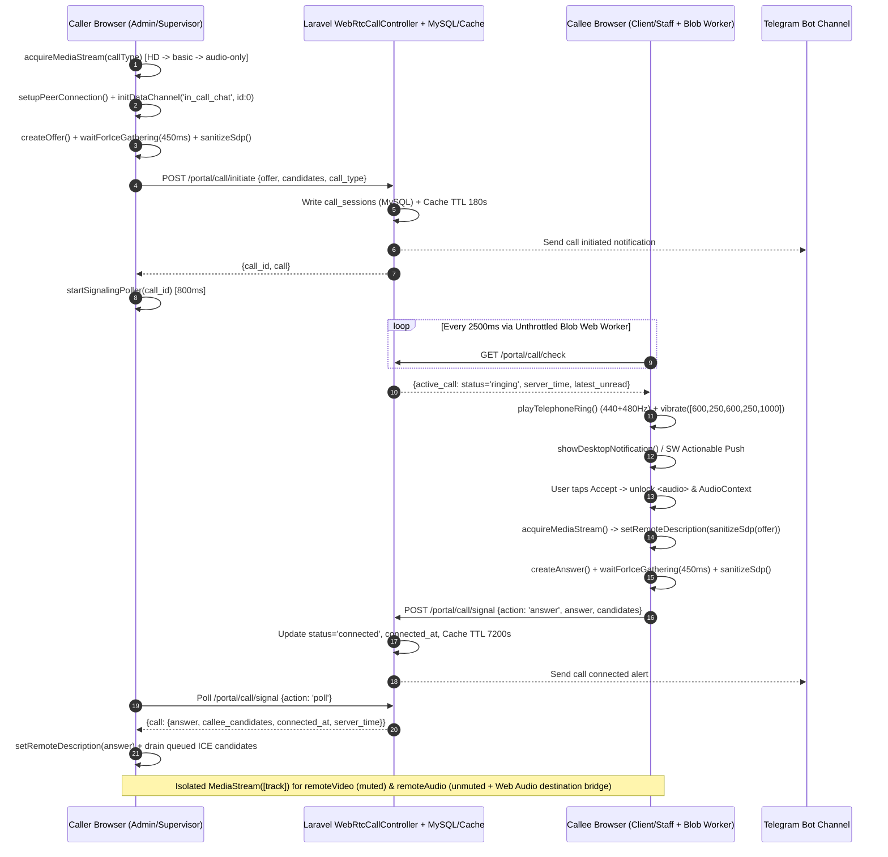
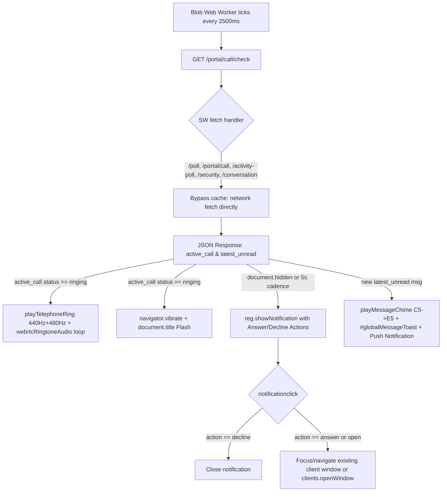
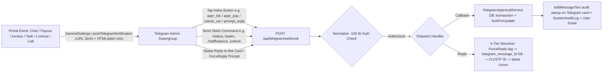

# System Implementation Chronicle: Hardened Chat, Native WebRTC Calling, Notifications & Ringing, and Telegram Control Center

**Repository:** `YourCpaExpert`  
**Document Scope:** Complete, end-to-end engineering chronicle from initial deployment (`4572be1`) through current HEAD (`e7322ca`)  
**Audited Revision Range:** `4572be1` (Nov 6, 2026) → `e7322ca` (Nov 9, 2026) — 37 chronological commits  

---

## Executive Summary

Between November 6 and November 9, 2026, the **YourCpaExpert** Laravel platform underwent an intensive architectural transformation across four tightly coupled real-time subsystems:

1. **Multi-Portal Hardened Chat System:** Unified, XSS-safe, duplicate-proof real-time messaging across the **Client Portal**, **Staff Portal**, and **Admin Practice Hub**, complete with file sharing, quick legal/accounting emoji bars, incremental DOM polling, and automated unread digests.
2. **Zero-Dependency Native WebRTC Voice & Video Engine:** Replaced an initial 3rd-party `meet.jit.si` iframe prototype within 71 minutes of inception with a custom, in-portal WebRTC peer-to-peer engine (`WebRtcCallController.php` + `resources/views/components/webrtc-call-modal.blade.php`). Hardened with dual MySQL + Cache signaling storage, Metered TURN/STUN NAT traversal, RFC 8830 Unified Plan SDP sanitization, audio/video stream isolation, P2P SCTP DataChannel in-call text chat, cross-platform screen sharing (desktop, Android `getDisplayMedia`, iOS camera fallback), Top-Pinned Dynamic Bar (PiP) minimization, and seamless SPA navigation persistence.
3. **Continuous Notification, Ringing, Sound & Vibration Engine:** Synthesized Web Audio API dual-tone ringers (440 Hz + 480 Hz) and portal chimes, `<audio>` background loops, hardware haptic vibration bursts (`navigator.vibrate`), an unthrottled Blob Web Worker background poller, header notification bells, mobile-responsive dropdowns, Service Worker (`public/sw.js` `cpa-portal-v4`) push + actionable call notifications (`Answer` / `Decline`), and cache-throttled missed-call emails.
4. **Two-Way Telegram Practice Command Center:** Full bi-directional operations control via Telegram webhooks (`TelegramWebhookController.php` + `TelegramApprovalService.php`), supporting 20+ slash commands, transactional inline keyboard callbacks (`appr_inv`, `appr_pay`, `appr_tsk`, `unlock_usr`, `pwd_usr`, `prompt_reply`), ForceReply multi-portal chat replies, automated SQL backups, daily practice digests, and live security/PIN administration.

This document records **exact architecture, implementation steps, routes, database schemas, every production error encountered, root causes, and fixes** across the entire build history.

---

## Master Chronological Build & Fix Timeline

| Phase | Commit Hash(es) | Date (PST) | Major Engineering Deliverable & Hardening Focus |
| :--- | :--- | :--- | :--- |
| **Phase 1: Foundation** | `4572be1`, `4d8ea5c` | Nov 6, 13:39–14:37 | Initial 2-way Telegram webhook bot, `TelegramApprovalService`, `GeneralSettings::sendTelegramNotification()`, automated SQL backup & daily digest commands, internal chat route wiring, initial `public/sw.js` (`cpa-staff-v1`). |
| **Phase 2: Chat Reliability & Alerts** | `479c81c`, `65aba43`, `f9854ac`, `a8224b2`, `8dc0613` | Nov 6, 14:59–21:51 | Fixed `case_documents` migration collision, added schema self-healing in `/setup`, fixed `$lastMessage` / null text crash, added Enter-to-send + JS in-flight locks eliminating duplicate chat sends, Telegram quick-reply ForceReply buttons, browser `Notification` API + Web Audio chime, fixed `staff_time_logs` column (`user_id` → `staff_user_id`), added idempotent column checks to migrations. |
| **Phase 3: Crisp Chat & Call Prototype** | `8799fea` | Nov 6, 22:55 | Fixed client 403 login redirect, added backend 3-second duplicate message suppression, added Magic Keyboard live typing sneak-peek (`saveTypingDraft`), upgraded Telegram `/setup-webhook` HTTPS normalization + supergroup `-100` ID normalization, added initial Jitsi `meet.jit.si` consultation call modal. |
| **Phase 4: Native WebRTC Launch** | `905e270`, `4a7fc26` | Nov 7, 00:06–00:34 | Replaced Jitsi iframe with native `WebRtcCallController` + `webrtc-call-modal.blade.php` across all 3 portals; removed Magic Keyboard live draft snooping ("airtight magic keyboard privacy"); added full `StaffMessage` file sharing; added 3-tier camera/mic acquisition fallback (`HD → basic → audio-only`) and dark-mode contrast fixes. |
| **Phase 5: Signaling, NAT & Timer Sync** | `b3b0319`, `dcc4b04`, `c0e0fda`, `05a3777`, `00ef29c` | Nov 7, 01:13–03:04 | Added TURN servers + `candidates_batch` trickle ICE + Admin `/setpin`; fixed `/setpin` SQL missing columns (`is_locked`, `failed_pin_attempts`, `account_locked_until`); migrated call signaling from volatile Cache-only to dual MySQL `call_sessions` + Cache and turned missing-call 404s into HTTP 200 `{status:'ended'}`; added `sanitizeSdp()`; synchronized `server_time` and `connected_at` duration timer. |
| **Phase 6: Screen Share, In-Call Chat & PiP** | `cee11c1` → `f376f0c` | Nov 7, 03:32–07:58 | Added in-call WebRTC DataChannel chat drawer; added cross-platform screen sharing (Desktop, Android `getDisplayMedia`, iOS rear-camera fallback, 1.5 Mbps detail encoding); added WhatsApp/FaceTime floating Top-Pinned Call Bar (PiP) minimization; added `getLatestUnreadMessageForUser` off-chat global toast + chime + missed-call email dispatch. |
| **Phase 7: Mobile Bells, Workers & Audio Bridge** | `81731f2` → `7ddea7b` | Nov 7, 11:06 – Nov 8, 12:18 | Upgraded SW to `push` + `notificationclick` listeners; added 2-hour Cache throttle on missed-call emails (`a6f5403`); added Client/Staff header notification bells and fixed minimize double-toggle race (`9053385`); fixed mobile bell dropdown clipping, added Blob Web Worker 2500ms unthrottled polling & seamless SPA navigation (`cf2c409`); moved `<audio id="webrtcRemoteAudio">` out of modal + muted `<video>` (`7ddea7b`). |
| **Phase 8: Stream Isolation & Telegram Ops** | `34b0023`, `dd0c639` | Nov 8, 18:25–19:43 | Isolated audio & video into separate `MediaStream([event.track])` containers; added `reconnectPeerConnection` (`reconnect_offer`) & `sessionStorage` call restoration; added retry poller for calling initialization; extended Telegram bot with `/tasks`, `/approvetask`, `/rejecttask`, `/payouts`, `/approvepayout`, `/rejectpayout`, `/clocked`, `/staffbalance`, `/documents` + `appr_tsk`/`rejc_tsk` callbacks; converted `let` → `var` in modal to fix syntax/redeclaration errors. |
| **Phase 9: Auth, PWA, Ringing & Concurrency** | `5032194`, `ee3ccb4`, `26c39dc`, `e7322ca` | Nov 9, 00:02–11:58 | Fixed caller ID resolution under `Auth::guard('admin')` (`5032194`); added `/setpin all`; added `webrtcRingtoneAudio` element + Web Audio `createMediaStreamSource` speaker bridge; added `Answer`/`Decline` SW notification actions (`ee3ccb4`); fixed broken `route('admin.conversations.index')` Ignition crash (`26c39dc`); added 4 consecutive empty-poll call drop protection & MySQL connected-call recovery; released PHP session locks (`@session_write_close()`) to eliminate Nginx 504 timeouts and JSON unlock errors (`5032194`, `e7322ca`). |

---

## Part I — Hardened Multi-Portal Chat System

### 1.1 Database Models & Schema Self-Healing

The platform operates two distinct persistent chat stores depending on participant relationship:

#### A. Client–Counsel Chat (`conversations`, `conversations_user`, `messages`)
- **Models:** `App\Models\Conversation`, `App\Models\Message`, linked via pivot table `conversations_user` (`conversation_id`, `user_id`).
- **Message Columns:** Both `text` and `message` fields are populated synchronously on write (`ClientViewController::sendChatMessage`, `WebRtcCallController::requestCall`, `WebRtcCallController::logCallOutcome`, `TelegramApprovalService::sendClientReplyFromTelegram`) to maintain compatibility across legacy and newly refactored blade views.
- **Attachments & Telegram Tracking:** `file`, `file_name`, `read` (boolean), plus columns added in `2026_11_07_000001_add_platform_enhancements_and_indexes.php`:
  - `telegram_message_id` (`VARCHAR(100)`, nullable, indexed)
  - `is_telegram_reply` (`BOOLEAN`, default `false`)

#### B. Staff–Supervisor Internal Chat (`staff_messages`)
- **Model:** `App\Models\StaffMessage` (`app/Models/StaffMessage.php`)
- **Fillable Attributes (verified in `905e270`):**
  ```php
  'staff_user_id', 'officer_user_id', 'sender_id', 'message',
  'read', 'telegram_message_id', 'is_telegram_reply', 'file', 'file_name'
  ```
- **Migration History & Guarding:** Initial `4572be1` and `4d8ea5c` introduced `telegram_message_id` and `is_telegram_reply`; commit `905e270` extended `2026_11_07_000001_add_platform_enhancements_and_indexes.php` to add `file` (`string(255)`) and `file_name` (`string(255)`) guarded by `Schema::hasColumn(...)` checks. Additionally, `routes/web.php` lines 78–92 included a runtime `/setup` self-healing block verifying `messages` and `staff_messages` columns automatically when an administrator initializes or repairs deployment environments.

### 1.2 Route Architecture Across All Three Portals

Verified from `routes/web.php`:

- **Client Portal (`/client/conversation/*`, prefix `client.`, controller `ClientViewController`):**
  - `GET /conversation/` (`client.conversation.index`) — Renders main native dark/light Crisp-style chat view.
  - `POST /conversation/store` (`client.conversation.store`) — Primary message + attachment submission endpoint.
  - `POST /conversation/send-chat/{slug?}` (`client.conversation.send-chat`) — Alternate AJAX/JSON chat endpoint.
  - `GET /conversation/poll/{slug}` (`client.conversation.poll`) — Incremental polling (`?last_id=X`).
  - `POST /conversation/typing-draft/{slug}` (`client.conversation.typing-draft`) — Endpoint retained for compatibility.
  - `GET /conversation/start-chat/{user}` (`client.conversation.start-chat`) — Initiates conversation with assigned counsel.
  - `GET /conversation/get-conversation/{slug}` (`client.conversation.get-conversation`) & `POST /conversation/send-message/{slug}` (`client.conversation.send-message`).

- **Admin Communications Hub (`/admin/conversation/*`, prefix `admin.conversation.`, controller `AdminController`) & Staff Chat (`AdminStaffController`):**
  - `GET /admin/conversation/` (`admin.conversation.index`) — Unified Communications Hub listing both Client threads and Staff threads (`b3b0319`).
  - `GET /admin/conversation/start-chat/{clientId}` (`admin.conversation.start-chat`) — Finds existing conversation between admin and client or creates one on the fly (`chat_{clientId}_{adminId}_{timestamp}`).
  - `GET /admin/conversation/get-conversation/{slug}` (`admin.conversation.get-conversation`) — Opens conversation thread.
  - `GET /admin/conversation/poll-live/{slug}` (`admin.conversation.poll-live`) — Incremental polling for admin view (`?last_id=X`).
  - `POST /admin/conversation/send-message/{slug}` (`admin.conversation.send-message`) — Admin send message + attachment endpoint.
  - `POST /admin/staff/messages/{id}` (`admin.staff.send-message` via `AdminStaffController::sendMessage`) — Admin/supervisor replying directly to a staff associate.

- **Staff Portal (`/staff/messages*`, prefix `staff.`, controller `StaffViewController`):**
  - `GET /staff/messages` (`staff.messages`) — Renders staff-supervisor encrypted chat view.
  - `POST /staff/messages` — Accepts text and/or multipart file attachments, stores file, notifies officer via email & Telegram.
  - `GET /staff/messages/poll` (`staff.messages.poll`) — Incremental AJAX polling (`?last_id=X`).

### 1.3 Client, Admin & Staff Chat UI Capabilities

1. **Responsive Crisp-Style Dark/Light Threading:**
   - Outgoing messages aligned right with high-contrast gradients (`linear-gradient(135deg, #1e3a8a 0%, #2563eb 100%)` on admin); incoming messages aligned left (`#1e293b` card with `#334155` border).
   - File attachment cards display `<i class="fas fa-paperclip">` / `<i class="fas fa-file-alt text-warning">` links routing through `route('download.chatting-file', $message->id)` (client/admin) or `asset($msg->file)` (staff).
2. **Quick Professional Emoji Toolbar:**
   - One-tap insertion (`insertEmoji`, `insertAdminEmoji`, `insertStaffEmoji`) preserving cursor `selectionStart`/`selectionEnd` for 12 practice-relevant glyphs: `😊 👍 📁 ⚖️ 💼 ✅ 🔒 📝 🤝 📎 💡 ❓`.
3. **Attachment Staging Preview:**
   - Selecting a file triggers `previewSelectedAttachment` / `previewAdminAttachment` / `previewStaffAttachment`, revealing a removable badge (`clearSelectedAttachment`, `clearAdminAttachment`, `clearStaffAttachment`) instead of submitting immediately on file change (`479c81c` originally used `onchange="this.form.submit()"`, which was upgraded in `8799fea` so users could attach a caption alongside files).
4. **Full Staff Chat File Sharing (`905e270`):**
   - Converted `#chat-form` in `resources/views/frontend/theme1/auth-staff/messages.blade.php` to `enctype="multipart/form-data"`, removed `required` from the `<textarea>` so pure file drops succeed, added `<input type="file" name="file" id="staffFileInput">`, and switched jQuery submission to `new FormData(formElement)` with `processData: false` and `contentType: false`.
5. **Cross-Side Incremental Polling & XSS Hardening:**
   - Every portal tracks the highest rendered `data-msg-id` (`lastMsgId` / `lastAdminMsgId`). Pollers pass `?last_id=` every 3.0s–3.5s, escape all dynamic text via `escapeHtml()` / `escapeAdminHtml()`, and guard against double insertion by checking `document.getElementById('msg-item-' + msg.id)` or `document.querySelector('[data-msg-id="..."]')`.

### 1.4 Duplicate Message Prevention & Magic Keyboard Privacy Hardening

#### Triple-Layer Anti-Duplicate Architecture
Early builds suffered from rapid `Enter` presses or simultaneous `keydown` + `submit` triggers posting identical messages twice (`479c81c` → `f9854ac` → `8799fea`). This was hardened in three distinct layers:
1. **Event-Level In-Flight Mutexes & Cooldown Debounce (`f9854ac`, `8799fea`):**
   - Admin (`messages.blade.php`): `isAdminSending` flag + `lastAdminSendTs` (`1200ms` window) inside `submitAdminForm()` and `form.addEventListener('submit')`, disabling `#adminSendBtn` with a spinner icon.
   - Client (`chat/index.blade.php`): `isSubmittingNativeChat` flag + `lastSendTimestamp` (`1000ms` window) inside `submitNativeChat()`, disabling `#nativeChatSendBtn` and restoring input text only if `fetch` rejects (removing the dangerous `catch(() => chatForm.submit())` fallback from `65aba43` that caused duplicate retries!).
   - Staff (`auth-staff/messages.blade.php`): `isSendingStaffMsg` flag + `lastStaffSendTs` (`1200ms` window) inside `submitStaffChat()`, calling `e.preventDefault(); e.stopPropagation(); return false;`.
2. **Instant Optimistic Clearing:** Inputs and file previews are cleared immediately upon request dispatch (before waiting for HTTP completion) so a fast second keystroke sees an empty payload.
3. **Backend 3-Second Deduplication (`8799fea`):**
   - `ClientViewController::sendChatMessage`: Queries `Message::where('conversation_id', ...)->where('user_id', $user->id)->where('text', $cleanMsg)->where('created_at', '>=', now()->subSeconds(3))->first()`. If found without an attachment, returns HTTP 200 `{success: true, duplicate: true}` cleanly without inserting a duplicate DB row.
   - `StaffViewController::sendMessage`: Runs the identical 3-second duplicate query on `StaffMessage` (`sender_id`, `message`, `created_at >= now()->subSeconds(3)`).

#### Magic Keyboard Privacy Hardening (`8799fea` → `905e270`)
- **Commit `8799fea`** introduced Crisp-style "Magic Keyboard Live Typing Sneak-Peek" (`saveTypingDraft` in `AdminController`, `ClientViewController`, and `StaffViewController`) caching partial keystrokes in `typing_draft_convo_{id}` / `typing_draft_staff_{id}` for 10 seconds and rendering them live in `#adminLiveTypingBox`, `#liveTypingPreviewBox`, and `#staffTypingSneakPeek`.
- **Commit `905e270`** explicitly enforced **airtight privacy** by removing all keystroke draft broadcast listeners (`input` event listeners, `triggerAdminTypingStream`, `triggerClientTypingStream`, `triggerStaffTypingStream`) and stripping live-draft sneak-peek banners from Client, Admin, and Staff message views so unsubmitted thoughts are never leaked to the counterparty before hitting Send.

---

## Part II — Native In-Portal WebRTC Voice & Video Call Engine

### 2.1 Architectural Pivot: Why `meet.jit.si` Iframes Were Replaced After 71 Minutes

In commit `8799fea` (Nov 6, 22:55), consultations initially launched inside an iframe pointing to `https://meet.jit.si/{room_id}` (`#adminConsultationRoomModal` and `#consultationRoomModal`). That approach depended on external Jitsi servers, imposed 3rd-party branding/moderator prompts, broke seamless UI minimization, and failed strict zero-external-login client workflows.

By commit `905e270` (Nov 7, 00:06), all Jitsi iframes were ripped out and replaced with a **100% first-party, native browser WebRTC P2P engine** (`App\Http\Controllers\WebRtcCallController` + `resources/views/components/webrtc-call-modal.blade.php`) included globally inside all three layout shells:
- `resources/views/backend/layouts/master-layout.blade.php`
- `resources/views/frontend/theme1/auth-client/layouts/master-layout.blade.php`
- `resources/views/frontend/theme1/auth-staff/layouts/master-layout.blade.php`

### 2.2 Global Signaling API (`routes/web.php` & `WebRtcCallController.php`)

All signaling routes sit under `middleware(['auth'])`, prefix `/portal/call`, named `portal.call.*`:

| Route & Name | Method | Controller Action | Responsibilities & Behavior |
| :--- | :--- | :--- | :--- |
| `/portal/call/initiate` (`portal.call.initiate`) | `POST` | `WebRtcCallController::initiate` | Enforces RBAC (`$user->hasAnyRole(['admin', 'supervisor']) \|\| !empty($user->is_admin)`). Validates `recipient_id`, `call_type` (`audio\|video`), `offer`, `candidates`, `conversation_slug`. Generates `call_{uniqid}_{rand}`. Writes full session JSON to MySQL `call_sessions` and Cache (`call_session_{id}` TTL 180s, `user_active_call_{recipientId}` TTL 180s, `user_active_call_{callerId}` TTL 180s). Sends rich Telegram launch alert. |
| `/portal/call/check` (`portal.call.check`) | `GET` | `WebRtcCallController::check` | Global heartbeat invoked every 2.5s. Looks up `user_active_call_{id}` in Cache; if missing, queries MySQL `call_sessions` for any `ringing` or `connected` call involving `$user->id` within the last 4 hours. Auto-expires `ringing` calls > 50s to `missed`. Also returns `server_time` and `latest_unread` message summary for off-chat global alerts. |
| `/portal/call/signal` (`portal.call.signal`) | `POST` | `WebRtcCallController::signal` | Exchanges `answer` (upgrades status to `connected`, sets `connected_at`, extends Cache TTLs to `7200s`, alerts Telegram), `reconnect_offer` (re-negotiates SDP during network drop/reload recovery), `candidate` (single trickle ICE), `candidates_batch` (array trickle ICE), and `poll` (returns full session + `server_time`). **Returns HTTP 200 `{status:'ended'}` when missing instead of 404.** |
| `/portal/call/respond` (`portal.call.respond`) | `POST` | `WebRtcCallController::respond` | Processes `accept`, `decline`, `end`, `cancel`, `missed`. Accepts optional client `duration_seconds` (falling back to `now() - connected_at`), updates MySQL & expires Cache (`15s`), posts formatted outcome message into `messages` or `staff_messages`, sends Telegram notification, and triggers missed-call email on timeout. |
| `/portal/call/request-call` (`portal.call.request-call`) | `POST` | `WebRtcCallController::requestCall` | Allows Clients and Staff (who cannot bypass RBAC to initiate calls directly) to log a structured callback request (`📞 Client/Staff requested a Voice/Video Call`) into the thread + Telegram alert for counsel/supervisors. |

### 2.3 Dual-Layer Signaling Storage: Volatile Cache → MySQL `call_sessions`

- **Initial Flaw (`905e270`):** `WebRtcCallController` stored call sessions exclusively in Laravel `Cache`. On shared hosting or multi-worker PHP environments, cache eviction or worker isolation caused `signal` calls to fail with `404 Call session expired or ended`.
- **MySQL Migration (`c0e0fda`):** Added `database/migrations/2026_11_07_000002_create_webrtc_call_sessions_table.php` AND runtime self-healing `WebRtcCallController::ensureTableExists()` so even before running `artisan migrate`, the `call_sessions` table auto-creates with columns:
  - `id`, `call_id` (unique string), `caller_id` (indexed), `recipient_id` (indexed), `caller_name`, `recipient_name`, `caller_avatar`, `recipient_avatar`, `call_type` (`default 'audio'`), `status` (`default 'ringing'`, indexed), `offer` (`longText`), `answer` (`longText`), `caller_candidates` (`longText` JSON), `callee_candidates` (`longText` JSON), `conversation_slug` (nullable), `connected_at` (`unsignedBigInteger`), `ended_at` (`unsignedBigInteger`), `timestamps`.
- **Dual-Write & Read-Through (`getCallSession()` & `26c39dc`):**
  - `getCallSession($callId)` checks `Cache::get("call_session_{$callId}")` first and transparently falls back to `DB::table('call_sessions')->where('call_id', $callId)->first()`, hydrating Cache (`7200s` if connected, `180s` if ringing) if absent.
  - `check()` queries MySQL whenever `user_active_call_{id}` cache misses; `26c39dc` expanded that fallback query from only `status = 'ringing'` (<60s) to `whereIn('status', ['ringing', 'connected'])` within the past **4 hours**, and refreshes `user_active_call_{user->id}` to **7200s** whenever a call is `connected`, guaranteeing live calls never drop if the cache clears mid-call.

### 2.4 STUN/TURN Infrastructure, Trickle ICE & SDP Sanitization

#### NAT Traversal Configuration (`rtcConfig`)
Configured in `webrtc-call-modal.blade.php` (`b3b0319` onward) to overcome symmetric carrier NAT and strict corporate firewalls:
- **10 STUN Servers:** `stun:stun.l.google.com:19302`, `stun1..stun4.l.google.com:19302`, `stun:stun.cloudflare.com:3478`, `stun:stun.services.mozilla.com`, `stun:stun.ekiga.net`, `stun:stun.voipbuster.com`, `stun:global.stun.metered.ca:80`.
- **3 Metered TURN Relay Servers:**
  - `turn:global.relay.metered.ca:80`
  - `turn:global.relay.metered.ca:443`
  - `turn:global.relay.metered.ca:443?transport=tcp`
- `iceCandidatePoolSize: 10` pre-gathers ICE candidates prior to `setLocalDescription` completion.

#### Batched Trickle ICE & Candidate Queuing
1. `waitForIceGathering(pc, 450)` gives the browser up to `450ms` during both `initiateWebRtcCall` and `acceptIncomingCall` (`26c39dc`) to bake host/STUN candidates straight into the initial SDP payload.
2. Any late ICE candidates from `peerConnection.onicecandidate` are pushed to `pendingLocalCandidates` and flushed in batches via `action: 'candidates_batch'` (rather than flooding HTTP requests per candidate).
3. Remote candidates received before `setRemoteDescription` are buffered safely and drained strictly afterward; `addedCandidateKeys` (`Set`) prevents duplicate `addIceCandidate()` exceptions across 800ms signaling polls.

#### Universal SDP Sanitizer (`sanitizeSdp()`)
- **Problem (`05a3777`):** Cross-browser calls (Desktop Chrome ↔ Mobile Chrome/Safari) failed with `InvalidAccessError` / `Invalid SDP line` due to bare `\n` line endings or malformed extra tokens appended after `a=ssrc:<id> msid:<stream> <track>`.
- **Fix Evolution:** Initially stripped all `a=ssrc: ... msid:` lines (`05a3777`), then refined in `7ddea7b` to normalize all `\r\n` / `\r` / `\n` endings to strict RFC 4566 CRLF (`\r\n`) and trim extra tokens on `a=ssrc: ... msid:` lines to at most 3 whitespace tokens (`parts.slice(0, 3).join(' ')`) so track association remains intact for Unified Plan without crashing Chromium's SDP parser.

### 2.5 Resilient Media Acquisition & Audio Routing Pipeline

#### 3-Tier `acquireMediaStream(callType)` Fallback (`4a7fc26`)
- **Video Calls (`callType === 'video'`):**
  1. Attempts HD video (`1280x720`) + hardware DSP audio (`echoCancellation: true`, `noiseSuppression: true`, `autoGainControl: true`).
  2. Falls back to generic `{ video: true, audio: true }`.
  3. Falls back to audio-only `{ audio: true, video: false }` so users without a webcam or with camera permission denied still enter the call smoothly with working voice!
- **Voice Calls (`callType === 'audio'`):** Never triggers browser camera permission prompts (`video: false`).

#### Solving One-Way / Silent Audio (`7ddea7b`, `34b0023`, `26c39dc`)
Several real-device bugs silenced remote audio before being systematically eliminated:
1. **Modal Visibility Destroying Audio (`7ddea7b`):** `#webrtcRemoteAudio` originally lived inside `#activeWebRtcCallModal`. Minimizing the modal set `display: none` or collapsed modal state, interrupting audio playback on mobile browsers. Moved `<audio id="webrtcRemoteAudio" autoplay playsinline>` to top-level DOM outside `#activeWebRtcCallModal` and pre-primed `play()` inside the caller/callee click gesture.
2. **Muted Video Track Silencing Shared MediaStream Audio (`34b0023`):** `event.streams[0]` bundles both remote audio and remote video tracks. Assigning `remoteVideo.srcObject = event.streams[0]` and setting `remoteVideo.muted = true` (to satisfy video autoplay rules) silenced the shared audio track on certain WebKit/Android builds! Resolved by creating **strictly isolated streams**: `remoteVideo.srcObject = new MediaStream([event.track])`.
3. **Autoplay Policy Block Recovery (`7ddea7b`):** Catching rejected `remoteAudio.play()` promises attaches one-shot `click` and `touchstart` listeners (`unlockAudio`) to immediately unmute and play audio upon the user's next tap.
4. **Web Audio API Destination Bridge (`26c39dc`):** Added an active Web Audio routing bridge (`audioContext.createMediaStreamSource(incomingAudioStream).connect(audioContext.destination)`) inside `ontrack` to force audio hardware routing into mobile speakers/earpieces even when HTMLMediaElement output stalls.

### 2.6 Synchronized Timers & Cross-Guard Caller Identification

- **Timer Skew Fix (`00ef29c`):** Previously caller and callee timers drifted based on local device clocks. `WebRtcCallController::signal()` and `check()` now inject `'server_time' => now()->timestamp`. The frontend compares `server_time` with `call.connected_at` via `markCallConnected()` and `startCallTimer(elapsed)` so both parties display synchronized `MM:SS` clocks across `#activeCallTimer` and `#pipCallTimer`, and `hangUpCall()` transmits `duration_seconds` cleanly to `respond()`.
- **Multi-Guard Admin Caller ID Fix (`5032194`):** When logged into the Admin portal using Laravel's `admin` guard, `Auth::id()` returned `null`/`0` inside the shared WebRTC blade component, stamping outgoing calls with `caller_id: 0`. Resolved by resolving `$webrtcActiveUser = Auth::guard('admin')->user() ?: Auth::user();` at the top of `webrtc-call-modal.blade.php`.

---

## Part III — In-Call Features: P2P Text Chat, Screen Sharing, PiP & Call Persistence

### 3.1 In-Call Peer-to-Peer DataChannel Text Chat (`initDataChannel`)

Implemented in `cee11c1` directly over the active `RTCPeerConnection` without hitting Laravel HTTP routes for in-call messages:
- **Deterministic Negotiated Channel:** Both peers initialize `peerConnection.createDataChannel('in_call_chat', { negotiated: true, id: 0 })` inside `setupPeerConnection()`, eliminating asymmetric channel negotiation delays.
- **UI Components (`webrtc-call-modal.blade.php`):**
  - Slide-out drawer `#webrtcInCallChatDrawer` overlaid inside the call stage, toggled via `#btnToggleInCallChat`.
  - Unread counter badge `#inCallChatUnreadBadge` increments automatically whenever messages arrive while the drawer has `d-none`, clearing upon drawer expansion.
  - Messages are serialized as JSON `{ type: 'chat', sender: currentUserName, text, time }` and appended via `appendInCallChatMsg()`.

### 3.2 Cross-Platform Screen Sharing (`toggleScreenShare` & `stopScreenShare`)

Engineered across `cee11c1`, `f376f0c`, and `34b0023` to work across desktop, Android, iOS, and both audio-only and video-only calls:
1. **Desktop Screen Capture:** Requests `navigator.mediaDevices.getDisplayMedia({ video: { cursor: 'always', width: { ideal: 1920 }, height: { ideal: 1080 }, frameRate: { ideal: 30 } }, audio: true })`.
2. **Mobile Android & iOS Fallbacks (`f376f0c`):**
   - Detects `/Android|iPhone|iPad|iPod/i.test(navigator.userAgent)`.
   - On Android browsers supporting `getDisplayMedia`, passes bandwidth-safe constraints (`width: { max: 1280 }, height: { max: 720 }, frameRate: { max: 15 }, audio: false`).
   - On iOS Safari (where `navigator.mediaDevices.getDisplayMedia` is unavailable), catches the missing API gracefully and prompts the user via `confirm()` to share their **Rear Camera (`facingMode: { ideal: 'environment' }`)** as a live document/screen feed!
3. **Track Replacement & Video Detail Encoding:**
   - Sets `screenVideoTrack.contentHint = 'detail'` for crisp ledger/PDF text legibility.
   - Locates or creates the video `RTCRtpSender` (`peerConnection.getSenders().find(...)` or `addTrack` / `addTransceiver('video', { direction: 'sendrecv' })`).
   - Calls `videoSender.replaceTrack(screenVideoTrack)` while preserving `originalCameraTrack` so clicking "Stop Sharing" restores the user's webcam seamlessly without renegotiating ICE.
   - Clamps sender encoding parameters via `videoSender.setParameters({ encodings: [{ maxBitrate: 1500000, maxFramerate: 15 }] })` (`f376f0c`) to protect mobile cellular uplinks.
   - Binds `screenVideoTrack.onended` so clicking the OS browser's native "Stop sharing" pill cleanly executes `stopScreenShare()`.

### 3.3 Top-Pinned Dynamic Call Bar (PiP) & Minimization Engineering

Added in `f376f0c` and refined in `9053385`, `cf2c409`, `34b0023`, `dd0c639`, `ee3ccb4`, and `26c39dc`:
- **DOM Architecture (`#webrtcTopPinnedCallBar`):** A WhatsApp/FaceTime-inspired floating pill fixed at `top: 12px; left: 50%; transform: translateX(-50%); z-index: 2147483647 !important`. Displays:
  - Pulsing green live dot + `"Live"` badge (`#pipCallBadge`).
  - Truncated peer name (`#pipCallPeerName`).
  - Synchronized monospace timer (`#pipCallTimer`: gold `#fecc56` on `#000000` with `1.5px` gold border).
  - Quick controls: Mute/Unmute (`#pipBtnMute`), Hang Up (`#pipBtnHangup`), and Expand button (`toggleCallMinimize(false)`).
- **Root Cause & Fix for Minimize Double-Toggle Bug (`9053385`, `34b0023`):**
  - **Bug:** Clicking `#btnMinimizeCall` or modal backdrop fired overlapping click and Bootstrap modal events that toggled `isCallMinimized` twice within milliseconds, leaving users stuck in an invisible modal overlay or locked page (`modal-open`).
  - **Fix:** Added explicit boolean parameter support `toggleCallMinimize(forceState)` (`34b0023`), enforced a `250ms` timestamp guard (`lastMinimizeToggleTime`), stripped `document.body.classList.remove('modal-open')` + reset `paddingRight = ''` + hid `.modal-backdrop` elements when minimized, and moved `onclick="toggleCallMinimize(true)"` / `toggleCallMinimize(false)` explicitly onto Minimize and Expand controls.
- **High-Contrast Mobile Overflow Fixes (`cf2c409`, `dd0c639`, `ee3ccb4`, `26c39dc`):** Enforced `!important` dark navy `#0b1120` background, removed conflicting `text-shadow`, capped pill width at `width: 94%; max-width: 440px` (`max-width: calc(100vw - 20px)`), and shrank mobile pill badges/buttons (`@media (max-width: 575.98px)`) so controls never wrap or clip off narrow phones even in Light Mode.

### 3.4 Call Persistence Across Reloads & Seamless In-Portal Navigation

Built across `34b0023`, `cf2c409`, `ee3ccb4`, and `26c39dc` so users can minimize a call, open documents/invoices/cases across the portal, or refresh a view without terminating the call:
1. **`sessionStorage` Call State Snapshots (`34b0023`):**
   - `saveCallPersistence(isMinimized)` serializes `call_id`, `call_type`, participants, `connected_at`, `isMinimized`, and timestamp to `sessionStorage['webrtc_call_persisted_state']`.
   - On page load, an IIFE `restorePersistedCall()` checks for snapshots under 1 hour old, restores timer elapsed seconds (`Math.floor(Date.now()/1000) - connected_at`), re-opens minimized PiP or modal UI, and invokes `reconnectPeerConnection(state)`.
   - **Call Drop Resilience (`26c39dc`):** In `handleCallPollResponse()`, transient network blips returning `!res.active_call` no longer terminate connected calls immediately—`consecutiveEmptyCallPolls` must exceed **4 consecutive empty polls** before triggering auto-hangup!
2. **Seamless SPA-Like Navigation (`navigateSeamlesslyDuringCall`, `cf2c409` → `ee3ccb4`):**
   - When `isCallActiveOrMinimized()` is true, interceptors listen on internal same-origin `<a>` link clicks (skipping `download`, `_blank`, `/logout`, `/stop-impersonation`, `#` hashes) and `window.popstate`.
   - Saves persistence snapshot, fetches the target route HTML cleanly via `fetch(targetUrl)`, parses it with `DOMParser`, swaps `#wrapper-content` (Admin), `.client-content-container` / `.client-content-col` (Client), or `.staff-content-container` / `.staff-content-col` (Staff), updates `document.title`, pushes browser history via `history.pushState`, and re-initializes navigation listeners—keeping the live `RTCPeerConnection` audio/video tracks untouched in memory!

---

## Part IV — Notifications, Continuous Ringing, Sounds, Vibrations & Service Worker

### 4.1 Zero-Dependency Synthesized Audio Engine (`webrtc-call-modal.blade.php`)

To guarantee audio playback never breaks due to missing MP3 assets, CORS failures, or CDN downtime, all ringing and alert chimes are synthesized dynamically in JavaScript using the **Web Audio API**:

1. **Incoming Telephone Dual-Tone Ringer (`playTelephoneRing()` / `stopTelephoneRing()`):**
   - Uses standard US/UK telephone cadence by summing two pure sine oscillators simultaneously at **440 Hz** and **480 Hz** through an exponential envelope (`gain` held at `0.85`–`0.90` for `1.8s`, tapering to `0.0001` at `1.95s`).
   - Repeats every `3200ms` (`26c39dc`, tightened from `4000ms` in initial `905e270`) as long as `isTelephoneRinging === true`.
   - Paired in `26c39dc` with a dedicated hidden `<audio id="webrtcRingtoneAudio" loop playsinline preload="auto">` element to sustain background audio execution while minimized.
2. **Portal Message & Notification Chimes:**
   - Global Unread Message Chime (`playMessageChime()`): Plays a crisp two-note interval (**C5 `523.25 Hz`** → **E5 `659.25 Hz`**).
   - Admin Global Activity Chime (`playAdminActivityChime()` in `backend/layouts/master-layout.blade.php`): Sweeps sine tone from **E5 `659.25 Hz`** → **A5 `880 Hz`**.
3. **Browser Autoplay Policy Unlocking:**
   - Browsers suspend `AudioContext` until a user interaction occurs. Every portal binds global one-shot `click` / `touchstart` listeners that resume `audioContext` (`audioContext.resume()`) and prime `<audio>` playback immediately on any touch or click.

### 4.2 Hardware Haptic Vibrations (`navigator.vibrate`)

Vibration patterns are calibrated by urgency across three touchpoints:
- **Foreground / Active Incoming Call Burst (`playTelephoneRing`):** `navigator.vibrate([600, 250, 600, 250, 1000])` pulsed every 3.2 seconds alongside audio bursts (`26c39dc`, intensified from `[400, 200, 400, 200, 800]` and `[500, 250, 500, 250, 1000]`).
- **System / Service Worker Call Push (`public/sw.js` & `showDesktopNotification`):** Extended high-alert cadence `[500, 250, 500, 250, 1000, 500, 500, 250, 500, 250, 1000]` with `requireInteraction: true`, `tag: 'incoming-call'`, and `renotify: true` so locked/sleeping Android handsets vibrate persistently until answered or declined.
- **Standard Chat / Admin Activity Alerts:** Short crisp pulse `[200, 100, 200]` (SW/toast messages) and `[150, 75, 150]` (`playAdminActivityChime` in `ee3ccb4`).

### 4.3 Unthrottled Background Polling via Inline Blob Web Worker

- **Problem (`cf2c409`):** Mobile Chrome, Edge, and Safari aggressively throttle background tab `setInterval()` timers (often delaying execution to 60+ seconds), causing users on another tab or with a dimmed screen to miss entire 50-second ringing call windows.
- **Solution (`initBackgroundCallWatcher()`):** Dynamically constructs an in-memory Web Worker from a Blob (`"setInterval(function() { postMessage('tick'); }, 2500);"`). Dedicated Worker threads are exempt from aggressive foreground tab timer clamping, triggering `pollCheck()` (`GET /portal/call/check`) reliably every **2.5 seconds** (falling back to main-thread `setInterval` only on restricted environments).
- **Hidden-Tab Repeated Re-Notification (`handleCallPollResponse`):** When `call.status === 'ringing'` and `document.hidden` is true (or every 5 seconds via `lastRingingNotifTime`), `showDesktopNotification()` re-dispatches an actionable OS notification alongside ring bursts and vibration until answered, declined, or timed out.

### 4.4 Service Worker (`public/sw.js`), Push Actions & Selective Bypass

`public/sw.js` evolved from `cpa-staff-v1` (`4572be1`) → `cpa-portal-v2` (`81731f2`) → `cpa-portal-v4` (current):
1. **Cache & Network-Only Bypass Rules:**
   - Caches core shell assets (`/manifest.json`, Bootstrap CSS, FontAwesome, dashboard background) under `CACHE_NAME = 'cpa-portal-v4'`, purging prior cache versions cleanly in the `activate` handler.
   - **Critical Fix (`fetch` listener):** Explicitly ignores `POST` / non-GET methods and bypasses all live API/signaling URLs (`/poll`, `/activity-poll`, `/portal/call`, `/security`, `/conversation`, `/webrtc`, `?expired`, `?t`) directly to `fetch(event.request)` so stale Service Worker cache entries never corrupt real-time chat or call states.
2. **Actionable Call Push Payloads (`push` listener & `showDesktopNotification`):**
   - Inspects `title` / `data.type` for `'call'` (`isCall`), attaches `actions: [{ action: 'answer', title: '📞 Answer Call' }, { action: 'decline', title: '🔴 Decline' }]` for calls vs `[{ action: 'open', title: 'View Message' }]` for messages (`ee3ccb4`).
3. **Notification Click Routing (`notificationclick` listener):**
   - Ignores/closes immediately on `event.action === 'decline'`.
   - Matches all open portal windows (`clients.matchAll({ type: 'window', includeUncontrolled: true })`), navigates the active client tab to `urlToOpen` (`client.navigate(urlToOpen)`), and focuses it (`client.focus()`), or launches a fresh standalone/tab window via `clients.openWindow(urlToOpen)`.

### 4.5 Off-Chat Global Toast Alerts, Title Flashing & Header Notification Bells

1. **Off-Chat Global Message Alerts (`f376f0c` → `a6f5403`):**
   - `WebRtcCallController::getLatestUnreadMessageForUser()` piggybacks on the 2.5s `check()` response (role-aware: admins check all unread client/staff messages within the past 12 hours; clients and staff check their scoped threads).
   - When a new unread message ID arrives on any portal page (`handleIncomingUnreadMessage`), `webrtc-call-modal.blade.php` renders the floating dark/gold `#globalMessageToast` bottom-right banner with deep-link URL, chimes via `playMessageChime()`, vibrates `[200, 100, 200]`, flashes the tab title via `startTitleFlash()`, and triggers `showDesktopNotification()`. Dismissed automatically after 12 seconds.
2. **Header Notification Bells & Mobile Positioning Fixes (`9053385`, `cf2c409`, `34b0023`, `ee3ccb4`, `26c39dc`):**
   - Added live database badge counters (`headerTotalAlerts`, `staffBellTotal`) to Client and Staff headers tracking unread chats + pending signature documents + assigned tasks.
   - Fixed right-edge overflow/clipping on mobile viewports (`<768px`) by overriding Bootstrap dropdown positioning with `position: fixed !important; top: 56px !important; left: 12px !important; right: 12px !important; width: auto !important;` (`#clientNotificationMenu`, `#staffNotificationMenu`, `#wrapper-header .dropdown-menu`) and hiding the desktop currency switcher below `lg`/`xl` breakpoints (`cf2c409`, `26c39dc`).
3. **Admin Global Activity Poller (`AdminController::pollGlobalAdminActivity` & `backend/layouts/master-layout.blade.php`):**
   - Polls `admin.activity-poll` for delta increases in `unread_client_msgs`, `unread_staff_msgs`, `pending_tasks`, `pending_payouts`, and `pending_proofs`.
   - Plays `playAdminActivityChime()` + vibrates `[150, 75, 150]` + triggers `triggerAdminPush(...)` + shows `toastr` banner.
   - **Critical Production Crash Fixed (`26c39dc`):** `master-layout.blade.php` lines 257–262 previously referenced non-existent Laravel route names `admin.conversations.index`, `admin.staff.tasks`, and `admin.staff.payouts`, throwing `Symfony\Component\Routing\Exception\RouteNotFoundException: Route [admin.conversations.index] not defined` on `/admin/dashboard`! Corrected to `admin.conversation.index`, `admin.staff.tasks.index`, and `admin.staff.payouts.index`.

### 4.6 Missed Call Branded Email Dispatch & PHP Session Lock Concurrency Fix

- **Branded Missed Call Emails (`WebRtcCallController::sendMissedCallEmail`, `f376f0c` → `a6f5403`):**
  - Triggered automatically when a call exceeds the 50-second `ringing` threshold (`check()`) or receives an explicit `'missed'` response (`respond()`).
  - Initially risk-prone to inbox flooding during rapid repeated retries; commit `a6f5403` added a strict **2-hour per-recipient Cache throttle** (`missed_call_email_{recipient->id}`).
- **Session Lock Release Stopping 504 Gateways & JSON Unlock Corruptions (`5032194`, `e7322ca`):**
  - **Root Cause:** Continuous 2.5s WebRTC call polling + Admin activity polling held exclusive PHP file-session locks while running multiple Eloquent queries. Simultaneous user navigation, security PIN unlock AJAX POSTs, or email/Telegram calls queued behind the session file lock until Nginx timed out (`504 Gateway Time-out`) or returned HTML login redirects instead of JSON (`Unexpected token '<', "<html> <h"... is not valid JSON`).
  - **Fix:** Added `@session_write_close()` immediately after `Auth::id()` inside polling endpoints (`AdminController::pollGlobalAdminActivity` line 704–706) alongside auth/timeout JSON response hardening in `5032194` & `e7322ca`, allowing concurrent polling and PIN/passkey verification to execute in parallel without mutex blocking.

---

## Part V — Two-Way Telegram Control, Manageability & Real-Time Notifications

### 5.1 Outbound Transport Layer (`GeneralSettings::sendTelegramNotification`)

Implemented in `app/Models/GeneralSettings.php` (lines 28–130) as the unified dispatcher for chat alerts, WebRTC call lifecycles, approvals, security unlocks, and cron digests:
- **Dynamic Configuration & Routing:** Reads `telegram_bot_token` and `telegram_chat_id` from `general_settings` (`$targetChatId ?: $settings->telegram_chat_id`), supporting optional `inline_keyboard` / `force_reply` JSON serialization via `reply_markup`.
- **Non-Blocking cURL Hardening:** Enforces strict timeouts (`CURLOPT_CONNECTTIMEOUT = 3s`, `CURLOPT_TIMEOUT = 4s`) so a transient Telegram API slowdown never stalls client/staff chat submits or login requests.
- **Automatic HTML Fallback Retry:** Telegram rejects `parse_mode = HTML` (HTTP 400) whenever unescaped `<`, `>`, or malformed tags appear inside user-supplied messages or case notes. When `!empty($responseData) && isset($responseData['ok']) && $responseData['ok'] === false`, `sendTelegramNotification` automatically strips HTML tags (`strip_tags($message)`), drops `parse_mode`, and retries immediately so critical alerts never vanish silently.

### 5.2 Webhook Ingestion, HTTPS Normalization & Supergroup Authorization (`TelegramWebhookController`)

- **Routes:**
  - `POST /api/telegram/webhook` (`routes/api.php:23`) → `TelegramWebhookController::handleWebhook`
  - `GET /telegram/setup-webhook` (`routes/web.php:445`) → `TelegramWebhookController::setupWebhook`
- **Setup Diagnostics (`8799fea`):** `setupWebhook()` rewrites `http://` URLs to `https://` for behind-proxy deployments (e.g., Cloudflare/Hostinger reverse proxies), registers `/api/telegram/webhook`, and queries `/getWebhookInfo` returning both `setup_status` and live `webhook_info` diagnostics.
- **Supergroup `-100` Prefix Authorization Fix (`8799fea`):**
  - **Root Cause:** Telegram prepends `-100` when groups upgrade to supergroups, causing strict string matches `$fromId === $adminChatId` / `$chatId === $adminChatId` to reject valid administrator commands silently.
  - **Fix:** Normalized IDs via `ltrim($id, '-100')` (`$normAdmin`, `$normFrom`, `$normChat`) across both `callback_query` and `message` handlers, logging rejected unauthorized payloads via `Log::warning(...)`.

### 5.3 Interactive Inline Keyboard Callbacks & Conversational Replies

Every actionable notification attaches inline buttons processed transactionally inside `TelegramWebhookController::handleWebhook()`:

| Callback Prefix | Service / Action Triggered | Post-Execution Telegram UI Mutation |
| :--- | :--- | :--- |
| `appr_inv:{id}` | `TelegramApprovalService::approveInvoiceProof($id, 'Telegram Admin')` | Edits card: appends `✅ STATUS: APPROVED & MARKED PAID by Admin at ...` |
| `rejc_inv:{id}` | `TelegramApprovalService::rejectInvoiceProof($id, ...)` | Edits card: appends `❌ STATUS: PROOF REJECTED by Admin at ...` |
| `appr_pay:{id}` | `TelegramApprovalService::approveStaffPayout($id, 'Telegram Admin')` | Edits card: appends `✅ STATUS: PAYOUT APPROVED & DISBURSED by Admin at ...` |
| `rejc_pay:{id}` | `TelegramApprovalService::rejectStaffPayout($id, ...)` | Edits card: appends `❌ STATUS: PAYOUT DECLINED by Admin at ...` |
| `appr_tsk:{id}` | `TelegramApprovalService::approveStaffTask($id, 'Telegram Admin')` | Edits card: appends `✅ TASK APPROVED & MARKED COMPLETED at ...` (`dd0c639`) |
| `rejc_tsk:{id}` | `TelegramApprovalService::rejectStaffTask($id, ...)` | Edits card: appends `⚠️ TASK RETURNED FOR REVISIONS at ...` (`dd0c639`) |
| `unlock_usr:{id}` | `TelegramApprovalService::unlockUser($id)` | Clears PIN locks (`failed_pin_attempts`, `is_locked`, `account_locked_until`), invalidates lock caches, audits action, notifies confirmation. |
| `pwd_usr:{id}` | Direct temporary password reset in webhook handler | Generates 8-char random temporary password, forces `is_temp_password = 1`, emails new credentials to user, notifies admin via Telegram. |
| `user_info:{id}` | Inspects user account, active cases, last activity | Posts structured summary card with quick unlock/reply/reset keyboard. |
| `prompt_reply:{type}:{id}` | Calls `sendForceReplyMessage(...)` | Sends Telegram `force_reply` prompt tagged `[Reply to: CLIENT|STAFF #{id}]` so admin can type directly in Telegram. |

#### 4-Tier Direct Reply Resolution (`TelegramWebhookController::handleDirectReply`)
When the administrator replies directly to a bot message in Telegram, resolution cascades cleanly across 4 fallbacks:
1. **Prompt Header Regex:** Matches `/\[Reply to: (CLIENT|STAFF) #(\d+)\]/i` from `ForceReply` prompts.
2. **Stored Telegram Message ID Lookup:** Matches `reply_to_message['message_id']` against `messages.telegram_message_id` or `staff_messages.telegram_message_id`.
3. **Structured Identifier Extraction:** Matches `CLI-0*(\d+)` (client) or `STF-0*(\d+)` (staff) inside the quoted original text.
4. **Latest Client Thread Fallback (`f9854ac`):** If replying to an older/unindexed alert, falls back to the most recent `Message` with an associated conversation so admin replies still route safely.

### 5.4 Complete Slash Command Reference (`TelegramWebhookController::handleCommand`)

| Command | Usage | Operational Capability |
| :--- | :--- | :--- |
| `/start`, `/help` | `/help` | Prints full interactive operations directory grouped by Monitoring, Tasks/Payouts, Users/PINs, and Messaging. |
| `/status` | `/status` | Live KPI snapshot: active cases, pending invoice proofs, pending staff payouts, clocked-in staff count, total client messages, server timestamp. |
| `/pending` | `/pending` | Streams up to 5 pending invoice proofs (`appr_inv`/`rejc_inv`) and 5 pending staff payouts (`appr_pay`/`rejc_pay`) with interactive cards. |
| `/tasks` | `/tasks` | Lists up to 6 submitted staff tasks (`status IN ['review', 'pending']`) with 1-click Approve/Revise inline buttons (`dd0c639`). |
| `/approvetask` | `/approvetask <id>` | Marks staff task completed, stamps `approved_at`, logs `STAFF_TASK_APPROVED`, emails staff member (`dd0c639`). |
| `/rejecttask` | `/rejecttask <id> [notes]` | Returns staff task to `pending`, logs `STAFF_TASK_REJECTED`, emails feedback notes to staff (`dd0c639`). |
| `/payouts` | `/payouts` | Streams up to 6 pending staff payout requests with inline `Approve Payout` / `Reject` buttons (`dd0c639`). |
| `/approvepayout` | `/approvepayout <id>` | Approves payout request transactionally, settles ledger hold, emails staff (`dd0c639`). |
| `/rejectpayout` | `/rejectpayout <id>` | Rejects payout request transactionally, deletes pending `payout_hold` ledger row, emails staff (`dd0c639`). |
| `/staffbalance` | `/staffbalance <id\|email>` | Calculates real-time hourly wages earned + net reimbursements/bonuses - debts - paid payouts - pending holds → **Available Claimable Balance** (`dd0c639`). |
| `/staff`, `/clocked` | `/staff` or `/clocked` | Lists currently clocked-in associates with shift start times and live elapsed hours/minutes. |
| `/cases` | `/cases` | Lists top 6 recent `ClientCase` records with case number, client name, title, and status. |
| `/documents` | `/documents` | Lists up to 6 pending `CaseDocument` files awaiting client e-signature (`requires_signature = true, is_signed = false`) (`dd0c639`). |
| `/invoices` | `/invoices` | Reports count and total balance of unpaid invoices plus top 5 unpaid line items. |
| `/user` | `/user <id\|email\|CLI-XXXX>` | Displays full user record, lock status, passkey/PIN readiness, and interactive `Unlock / Reset 2FA`, `Reset Temp Password`, `View Active Cases` keyboard. |
| `/unlock` | `/unlock <id\|email>` | Immediately clears `failed_pin_attempts`, `is_locked`, `account_locked_until`, and lock Cache keys. |
| `/pin`, `/setpin` | `/setpin <4-digit>` / `/setpin <id\|email> <pin>` / `/setpin all <pin>` | Configures `pin_hash` and enables `two_factor_enabled = 1` *(see Part VII for duplicate `switch` branch note in current HEAD)*. |
| `/reply` | `/reply <user_id> <message>` | Sends direct portal reply from Telegram (checks staff vs client role automatically). |
| `/broadcast` | `/broadcast <text>` | Emails practice-wide announcement across active portal users and confirms recipient count. |
| `/backup` | `/backup` | Invokes `DatabaseBackupService::createAndSendBackup` synchronously and ships compressed SQL dump straight into Telegram chat. |

### 5.5 Transactional Integrity & Scheduled Automation (`TelegramApprovalService` & Console Commands)

- **Locking & Concurrency (`TelegramApprovalService.php`):**
  - `approveInvoiceProof`, `rejectInvoiceProof`, `approveStaffPayout`, `rejectStaffPayout` all execute inside `DB::transaction()` with `lockForUpdate()`, refusing double-processing if clicked twice (`"already processed"`).
  - Payout approval (`34b0023`) specifically locates any matching `StaffLedgerEntry` with `type = 'payout_hold'` (`like %#{payout->id}%`) and converts it in-place to `type = 'payout', status = 'paid'` (or deletes it on rejection) rather than double-deducting the staff ledger balance.
  - All outbound Telegram replies validate schema columns (`Schema::hasColumn('messages', 'telegram_message_id')`, `Schema::hasColumn('staff_messages', 'telegram_message_id')`) prior to inserting tracking IDs so schema lag never crashes reply delivery.
- **Automated Artisan Commands & Cron Endpoints (`app/Console/Commands/` & `routes/web.php`):**
  - `practice:daily-digest` (`SendDailyPracticeDigest`, HTTP `/cron/daily-digest`)
  - `practice:weekly-backup` (`SendWeeklyDatabaseBackup`, HTTP `/cron/weekly-backup`)
  - `messages:notify-unread` (`SendUnreadMessagesDigest`, HTTP `/cron/messages-unread-digest`)

---

## Part VI — Complete Error & Resolution Ledger (`4572be1` → `e7322ca`)

Every error encountered during development and production testing across Chat, WebRTC, Notifications, PWA/UI, and Telegram is cataloged below in chronological order:

| # | Symptom / Failure Observed | Root Cause Analysis | Exact Engineering Fix | Commit(s) |
| :--- | :--- | :--- | :--- | :--- |
| **1** | Database migration failed with collision on `case_documents` & duplicate columns in `case_milestones`, `staff_time_logs`, `invoices` during setup. | Migrations ran `Schema::table` blindly without checking existing column presence from earlier partial runs. | Wrapped `Schema::table` additions in `Schema::hasColumn(...)` / `Schema::hasTable(...)` guards and added runtime schema self-healing in `/setup` (`routes/web.php`). | `479c81c`, `8dc0613` |
| **2** | `Attempt to read property "text" on null` / Undefined `$lastMessage` crash in Admin Conversations list. | Conversations with zero messages returned `null` for `$lastMessage`, and `$lastMessage->text` wasn't null-safe. | Added null-safe `$lastMessage?->text` checks and Controller fallback menu null guards. | `479c81c`, `8799fea` |
| **3** | SQL error referencing `staff_time_logs.user_id` in Staff portal sidebar. | `staff_time_logs` foreign key column is named `staff_user_id` (not `user_id`) in left-bar query. | Updated sidebar query to `staff_user_id`. | `a8224b2` |
| **4** | Client portal login returned **403 Unauthorized** or redirected back into broken guard flow. | Fortify / Guest authentication redirects conflicted with client role middleware redirects. | Updated `FortifyServiceProvider`, `GuestViewController`, and `AppServiceProvider` auth routing. | `f9854ac`, `8799fea` |
| **5** | Pressing `Enter` rapidly in chat posted **duplicate messages** in Client, Staff, and Admin chats. | Simultaneous `keydown` + `submit` firing plus HTTP fallback (`catch(() => chatForm.submit())` in `65aba43`) re-posted requests already received by the server. | Implemented triple-layer anti-duplicate pipeline: in-flight mutexes (`isAdminSending`, `isSubmittingNativeChat`, `isSendingStaffMsg`), `1000–1200ms` debounce timestamps, instant input clearing, removal of fallback POST resubmit, and 3-second server-side SQL deduplication. | `f9854ac`, `8799fea` |
| **6** | Unsent typing drafts visible to counterparty caused privacy concerns. | Crisp-style `saveTypingDraft` polled every 300ms and displayed live keystrokes prior to submission. | Removed all keystroke listeners, draft AJAX callers, and live sneak-peek DOM boxes across Client, Staff, and Admin views. | `905e270` |
| **7** | Telegram Bot silently ignored messages and button callbacks from Practice Supergroup. | Upgrading a Telegram group to a Supergroup prepends `-100` to `chat_id`, failing exact string equality checks against saved `telegram_chat_id`, and `http://` webhook URLs failed HTTPS binding. | Added `ltrim($id, '-100')` ID normalization on callbacks & messages, forced `https://` in `/telegram/setup-webhook`, and surfaced `getWebhookInfo` diagnostics. | `8799fea` |
| **8** | Telegram `/setpin` crashed with SQL error (`Unknown column 'is_locked' / 'failed_pin_attempts'`) or `Unknown column 'is_admin'`. | Early `/setpin` queried `is_admin` column that didn't exist in `users` table and wrote to missing lock columns on older schemas. | Added `failed_pin_attempts`, `is_locked`, `account_locked_until` to `2026_11_07_000001` migration, guarded writes with `isset()`, and removed erroneous `->orWhere('is_admin', 1)` query from `TelegramWebhookController`. | `dcc4b04`, `34b0023` |
| **9** | Telegram HTML notifications containing unescaped `&` or user `<tags>` failed silently (HTTP 400 from Telegram API). | Strict `parse_mode = HTML` rejects malformed HTML entities in dynamic case/chat strings. | Updated `GeneralSettings::sendTelegramNotification()` to check `'ok' === false` and retry automatically with `strip_tags($message)` in plain text. | `4572be1` / `GeneralSettings.php` |
| **10** | WebRTC call setup crashed immediately when local camera was missing, busy, or denied permission. | `getUserMedia({ video: true, audio: true })` threw `NotFoundError` / `NotReadableError` / `NotAllowedError` with no fallback. | Built 3-tier `acquireMediaStream()`: HD video+DSP audio → generic `{video:true, audio:true}` → audio-only `{audio:true, video:false}`. | `4a7fc26` |
| **11** | Cross-network calls stalled in `"Connecting..."` indefinitely behind NAT/firewalls. | STUN-only configuration failed symmetric carrier NAT traversal. | Added 3 Metered `TURN` relays (port 80 UDP, port 443 UDP, port 443 TCP), expanded STUN pool to 10 servers, added `waitForIceGathering()` + `candidates_batch` trickle ICE. | `b3b0319` |
| **12** | Active calls dropped with repeated **404 errors** on `/portal/call/signal` & `/check`. | Volatile `Cache`-only signaling lost state under cache clears / short 60s TTLs, and missing sessions returned HTTP 404. | Created MySQL `call_sessions` table (`2026_11_07_000002` + runtime `ensureTableExists()`), moved to Cache + MySQL dual-write, returned HTTP 200 `{status:'ended'}` instead of 404, added MySQL connected-call 4-hour recovery, and added 4 consecutive empty-poll grace tolerance (`consecutiveEmptyCallPolls <= 4`). | `c0e0fda`, `26c39dc` |
| **13** | Cross-browser Android/Chrome calls rejected remote offer/answer with `Invalid SDP line` / `ssrc msid` error. | Non-CRLF line endings or trailing parser tokens appended to `a=ssrc: ... msid:` lines broke Chromium's Unified Plan SDP parser. | Implemented `sanitizeSdp()` normalizing all line endings to `\r\n` and clamping `a=ssrc: ... msid:` lines to 3 tokens cleanly. | `05a3777`, `7ddea7b` |
| **14** | Caller and Callee call duration timers drifted out of sync (`00:05` vs `00:18`). | Local client clocks ran independently without referencing a canonical start timestamp. | Added `'server_time' => now()->timestamp` + `connected_at` sync on signaling polls and client `duration_seconds` transmission on hangup. | `00ef29c` |
| **15** | Remote audio went **silent** during minimized calls or on mobile devices while video was active. | (a) `#webrtcRemoteAudio` lived inside `#activeWebRtcCallModal` which was toggled hidden; (b) `remoteVideo.muted = true` silenced the shared `event.streams[0]` audio track; (c) browser autoplay policy blocked ungesture-linked playback. | (a) Moved `#webrtcRemoteAudio` to top-level DOM; (b) split video & audio into strictly isolated `new MediaStream([event.track])`; (c) attached `click`/`touchstart` autoplay unlockers + Web Audio `createMediaStreamSource` speaker destination bridge. | `7ddea7b`, `34b0023`, `26c39dc` |
| **16** | Clicking Minimize double-toggled modal state or trapped user on an invisible grey backdrop; PiP bar overflowed mobile widths or turned illegible in Light Mode. | Overlapping click + Bootstrap modal events toggled state twice in <50ms; Bootstrap `modal-open` class remained on `body`; desktop pill lacked mobile CSS caps. | Added `toggleCallMinimize(true/false)` explicit state args, 250ms `lastMinimizeToggleTime` debounce, cleanup of `modal-open` & `.modal-backdrop`, forced `!important` high-contrast `#0b1120`/`#fecc56` pill CSS, and `94%` / `max-width: 440px` sizing. | `9053385`, `cf2c409`, `34b0023`, `dd0c639`, `ee3ccb4`, `26c39dc` |
| **17** | Mobile browsers paused incoming call detection when tab was backgrounded or screen locked. | Standard `setInterval` timers are throttled by mobile browsers in inactive tabs. | Moved `/portal/call/check` ticker into an inline Blob **Web Worker** (`2500ms` interval immune to background tab throttling) + repeated 5s `showDesktopNotification()` & vibration bursts + `<audio id="webrtcRingtoneAudio" loop>`. | `cf2c409`, `26c39dc` |
| **18** | Missed-call timeouts spammed recipients with duplicate emails on every check poll before cleanup. | Unthrottled timeout check fired `Mail::html()` repeatedly across concurrent polling requests. | Added strict 2-hour per-recipient Cache throttle (`missed_call_email_{id}`) inside `sendMissedCallEmail()`. | `a6f5403` |
| **19** | Header notification bell dropdown clipped off the right edge of phone screens. | Default Bootstrap dropdown alignment overflowed narrow `320px–420px` mobile viewports alongside visible currency switcher. | Overrode `#clientNotificationMenu`, `#staffNotificationMenu`, and `#wrapper-header .dropdown-menu` with `position: fixed !important; left: 12px; right: 12px;` under `<768px` and hid currency switcher on smaller screens. | `cf2c409`, `34b0023`, `26c39dc` |
| **20** | JavaScript `SyntaxError` / `"Identifier already declared"` & `"Calling engine is initializing"` alert on Admin chat pages. | Top-level `let` variables in component script collided during partial swaps, and clicking Call before deferred script parsed alerted prematurely. | Converted modal state variables from `let` to `var` (`dd0c639`) and added a 40x `150ms` retry poll (`checkInterval`) before alerting (`34b0023`). | `34b0023`, `dd0c639` |
| **21** | Admin-initiated calls stamped `caller_id: 0` or `"User"`, failing call identification. | Admin sessions under `Auth::guard('admin')` were invisible to default `Auth::id()`. | Updated `webrtc-call-modal.blade.php` to resolve `$webrtcActiveUser = Auth::guard('admin')->user() ?: Auth::user();` (`5032194`). | `5032194` |
| **22** | `/admin/dashboard` crashed with **`Symfony\Component\Routing\Exception\RouteNotFoundException: Route [admin.conversations.index] not defined.`** | `backend/layouts/master-layout.blade.php` global activity poller used plural `admin.conversations.index`, `admin.staff.tasks`, and `admin.staff.payouts` instead of actual defined route names. | Fixed all route calls in `master-layout.blade.php` to `admin.conversation.index`, `admin.staff.tasks.index`, and `admin.staff.payouts.index`. | `26c39dc` |
| **23** | Nginx **`504 Gateway Time-out`** & **`Unexpected token '<', "<html> <h"... is not valid JSON`** on PIN/Session Unlock modals. | Background 2.5s pollers and admin activity pollers held PHP file-session locks exclusively across multi-query responses, starving concurrent login/unlock POSTs until timeout or HTML redirect. | Added `@session_write_close()` right after reading `Auth::id()` inside `pollGlobalAdminActivity()` and hardened JSON/auth unlock concurrency in `5032194` & `e7322ca`. | `5032194`, `e7322ca` |

---

## Part VII — Verified Current Technical Observations (Audit of HEAD `e7322ca`)

During verification of the current codebase at `e7322ca`, two minor residual defects were directly observed in source files and are documented here transparently so they can be cleanly addressed in a future maintenance patch:

1. **Duplicate `case '/setpin':` Switch Branch (`app/Http/Controllers/TelegramWebhookController.php`):**
   - `TelegramWebhookController.php` defines `case '/pin':` / `case '/setpin':` twice inside the same `switch ($command)` statement:
     - **First branch (line 472):** Calls `TelegramApprovalService::setUserPin($userId, $pin)` and hits `break;` unconditionally at line 481.
     - **Second branch (lines 560–651):** Contains the expanded bulk logic added in `b3b0319`, `a6f5403`, `dd0c639`, and `5032194` (including `/setpin all <pin>` and `/setpin <4-digit-pin>` for all Admin/Staff accounts). Because PHP matches the first matching `case '/setpin':` and breaks at line 481, the second `/setpin` block at line 561 is currently shadowed unless merged cleanly into a single `case '/pin': case '/setpin':` handler.
2. **Reconnect Poller Function Reference Mismatch (`resources/views/components/webrtc-call-modal.blade.php:2192`):**
   - Inside `reconnectPeerConnection(call)` (introduced in `34b0023`), line 2192 invokes `pollSignalingUpdates(call.call_id)`, whereas the signaling poller defined at line 1497 of the same file is named `startSignalingPoller(callId)`. Page-reload call reconnection should invoke `startSignalingPoller(call.call_id)` so post-reconnect trickle ICE candidates and offers poll reliably.

---

## Appendix A — End-to-End Signaling, Notification & Telegram Architecture Flows

### A.1 Native WebRTC Call Setup, ICE Exchange, Audio Isolation & Persistence Flow



### A.2 Service Worker (`public/sw.js` `cpa-portal-v4`) & Background Alert Pipeline



### A.3 Two-Way Telegram Control & ForceReply Flow



---

## Appendix B — Canonical `call_sessions` Schema Reference (`WebRtcCallController::ensureTableExists`)

| Column | Type / Length | Index / Modifier | Purpose |
| :--- | :--- | :--- | :--- |
| `id` | `BIGINT UNSIGNED` | Primary Key, Auto-increment | Surrogate row identifier |
| `call_id` | `VARCHAR(64)` | `UNIQUE` | Client/server call UUID (`call_{uniqid}_{rand}`) |
| `caller_id` | `BIGINT UNSIGNED` | Indexed | Initiating Admin / Supervisor user ID |
| `recipient_id` | `BIGINT UNSIGNED` | Indexed | Target Client or Staff user ID |
| `caller_name` | `VARCHAR(255)` | Nullable | Display name cached at call initiation |
| `caller_avatar` | `VARCHAR(255)` | Nullable | Avatar URL for incoming call modal |
| `recipient_name` | `VARCHAR(255)` | Nullable | Display name cached at call initiation |
| `recipient_avatar` | `VARCHAR(255)` | Nullable | Target avatar URL |
| `call_type` | `VARCHAR(20)` | Default `'audio'` | `'audio'` or `'video'` |
| `status` | `VARCHAR(20)` | Default `'ringing'`, Indexed | `'ringing'`, `'connected'`, `'ended'`, `'declined'`, `'missed'`, `'cancelled'` |
| `offer` | `LONGTEXT` | Nullable | JSON-encoded RTCSessionDescription offer |
| `answer` | `LONGTEXT` | Nullable | JSON-encoded RTCSessionDescription answer |
| `caller_candidates` | `LONGTEXT` | Nullable | JSON array of caller ICE candidates |
| `callee_candidates` | `LONGTEXT` | Nullable | JSON array of callee ICE candidates |
| `conversation_slug` | `VARCHAR(100)` | Nullable, Indexed | Associated `Conversation::slug` (null for staff calls) |
| `decline_reason` | `VARCHAR(255)` | Nullable | Optional decline reason recorded on refusal |
| `connected_at` | `BIGINT UNSIGNED` | Nullable | Canonical Unix epoch timestamp when answered |
| `ended_at` | `BIGINT UNSIGNED` | Nullable | Canonical Unix epoch timestamp when terminated |
| `created_at`, `updated_at` | `TIMESTAMP` | Nullable | Standard Eloquent/DB timestamps used for 50s timeout & 4h recovery |

---

## Appendix C — Verified Primary Source File Inventory

- **Controllers:**
  - `app/Http/Controllers/WebRtcCallController.php` — Native WebRTC signaling, MySQL/Cache persistence, missed call email throttling, global unread polling
  - `app/Http/Controllers/TelegramWebhookController.php` — Webhook auth normalization, slash command router, inline callback router, 4-tier ForceReply handler
  - `app/Http/Controllers/AdminControllers/AdminController.php` — Admin client conversations hub, `pollLiveState`, `pollGlobalAdminActivity` (`@session_write_close()`)
  - `app/Http/Controllers/ClientViewControllers/ClientViewController.php` — Client chat submission, 3-second deduplication, incremental polling
  - `app/Http/Controllers/StaffControllers/StaffViewController.php` — Staff encrypted chat, multipart file attachments, 3-second deduplication
- **Services, Models & Console:**
  - `app/Services/TelegramApprovalService.php` — Transactional approval/rejection locks for invoices, payouts, tasks, user unlocks, and Telegram-originated replies
  - `app/Models/GeneralSettings.php` — Non-blocking cURL Telegram transport with automatic plain-text fallback
  - `app/Models/StaffMessage.php` — Internal messaging model with `telegram_message_id`, `is_telegram_reply`, `file`, `file_name`
  - `app/Console/Commands/SendDailyPracticeDigest.php` (`practice:daily-digest`)
  - `app/Console/Commands/SendWeeklyDatabaseBackup.php` (`practice:weekly-backup`)
  - `app/Console/Commands/SendUnreadMessagesDigest.php` (`messages:notify-unread`)
- **Database Migrations:**
  - `database/migrations/2026_11_07_000001_add_platform_enhancements_and_indexes.php` — Telegram tracking, lock/PIN columns, staff message file columns
  - `database/migrations/2026_11_07_000002_create_webrtc_call_sessions_table.php` — Persistent MySQL `call_sessions` schema
- **Frontend & PWA Layer:**
  - `resources/views/components/webrtc-call-modal.blade.php` — Unified WebRTC engine, DataChannel chat drawer, screen sharing, Top-Pinned Dynamic Bar (PiP), Web Audio synthesizer, Blob Web Worker, SPA navigation persistence
  - `public/sw.js` — Service Worker (`cpa-portal-v4`) selective bypass + push & interactive call notification handlers
  - `resources/views/backend/layouts/master-layout.blade.php` — Admin shell, activity poller, WebRTC modal mount, mobile responsive CSS
  - `resources/views/frontend/theme1/auth-client/layouts/master-layout.blade.php` — Client shell, notification bell, WebRTC modal mount
  - `resources/views/frontend/theme1/auth-staff/layouts/master-layout.blade.php` — Staff shell, notification bell, WebRTC modal mount
  - `resources/views/frontend/theme1/auth-client/pages/chat/index.blade.php`, `resources/views/backend/pages/conversations/messages.blade.php`, `resources/views/frontend/theme1/auth-staff/messages.blade.php` — Multi-portal chat UI views
  - `routes/web.php` & `routes/api.php` — Complete HTTP route bindings
